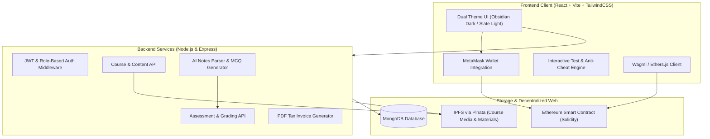
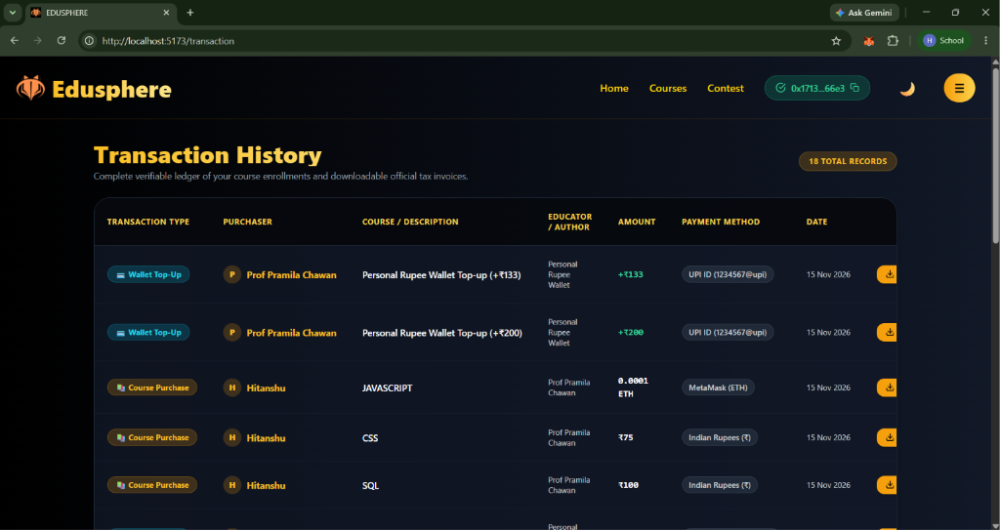
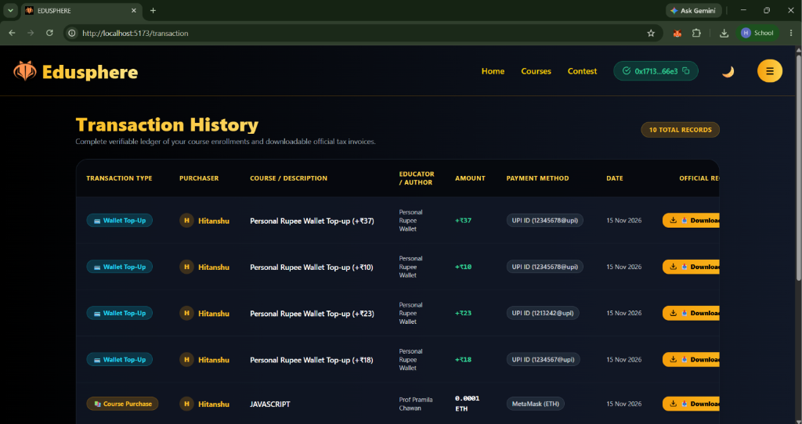
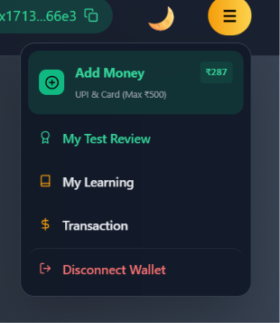
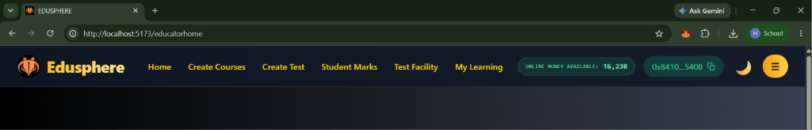
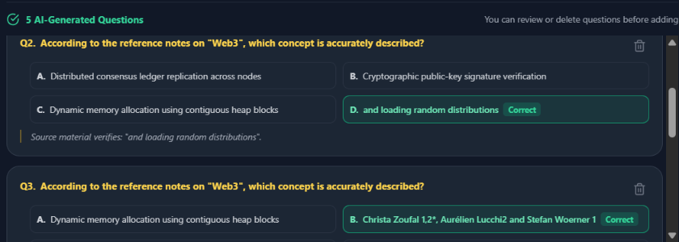
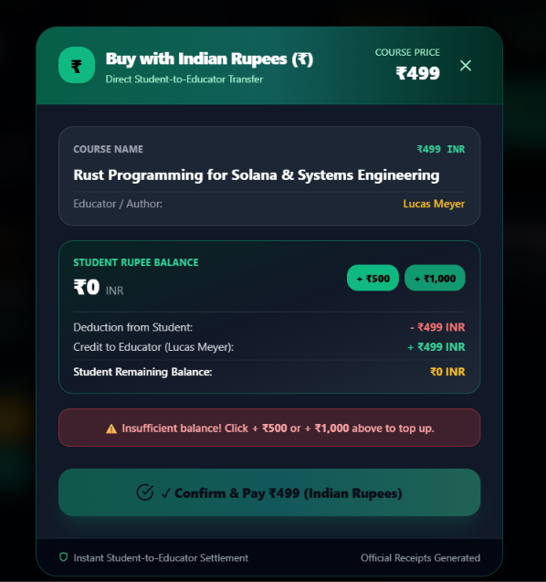
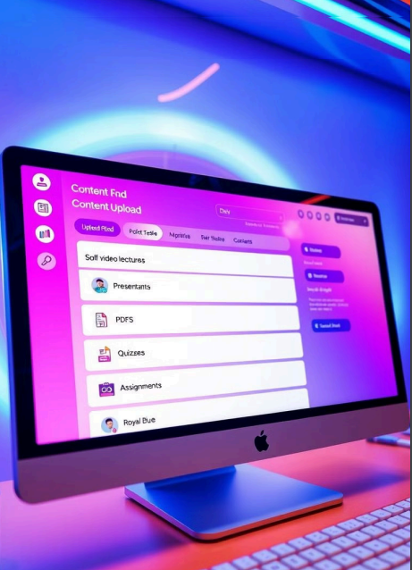

<h1 align="center">
  <a href="https://github.com/DARSHITSHAH-2906/Inheritance_Edusphere">
    
  </a>
  <br>
  <b>EDUSPHERE</b>
</h1>

<p align="center">
  <b>Next-Generation Decentralized Hybrid E-Learning & Assessment Platform</b>
  <br>
  <i>Empowering educators and students with Web3 smart contract ownership, AI-driven assessments, lifetime course access, and dual ETH/Fiat payment rails.</i>
</p>

<p align="center">
  
  
  
  
  
  
  
</p>

<hr>

<details open>
<summary><b>Table of Contents</b></summary>

- [🌟 Executive Summary](#-executive-summary)
- [✨ Key Features & Recent Upgrades](#-key-features--recent-upgrades)
- [🏗️ System Architecture](#️-system-architecture)
- [👥 Role-Based Workflows](#-role-based-workflows)
  - [👨‍🏫 Educator Experience](#-educator-experience)
  - [👨‍🎓 Student Experience](#-student-experience)
- [🤖 AI Assessment & Test Facility](#-ai-assessment--test-facility)
- [💳 Dual-Rail Payment & Invoicing Engine](#-dual-rail-payment--invoicing-engine)
- [💻 Tech Stack Overview](#-tech-stack-overview)
- [📱 Platform Screenshots & Feature Walkthrough](#-platform-screenshots--feature-walkthrough)
- [🛠️ Local Installation & Setup](#️-local-installation--setup)
- [📂 Project Directory Structure](#-project-directory-structure)
- [👨‍💻 Team & Mentors](#-team--mentors)

</details>

<hr>

## 🌟 Executive Summary

**Edusphere** is a hybrid decentralized education ecosystem designed to eliminate intermediaries in online education, preserve creator royalties, prevent content piracy, and revolutionize academic assessments.

By unifying **Ethereum Smart Contracts**, **Decentralized Storage (IPFS via Pinata)**, a high-performance **MERN Backend**, and an **AI Question Bank Generator**, Edusphere creates an immutable, verifiable, and user-centric learning environment. Whether students purchase courses using Ethereum (ETH) via MetaMask or Indian Rupees (₹) via instant UPI, their course ownership is recorded permanently with **guaranteed lifetime access**.

---

## ✨ Key Features & Recent Upgrades

### 1. 🛡️ Guaranteed Lifetime Course Access
- Enrolled students maintain unrevokable lifetime access to course videos and materials in **My Learning**.
- Even if an educator archives or deletes a course from their dashboard, existing student enrollments remain intact in the database and on-chain.

### 2. ⚡ AI-Powered Assessment & Test Facility
- **Automated MCQ Generation**: Upload lecture notes, course slides, or syllabus files (`.pdf`, `.docx`, `.txt`) to generate targeted multiple-choice question banks automatically using AI.
- **Dataset Import**: Batch import question banks directly from `.csv`, `.tsv`, or `.json` files.
- **Proctored Testing Engine**: Anti-copy protection, randomized question sampling, countdown timers, automated grading, and instant educator solutions.

### 3. 💳 Dual-Rail Payment Ecosystem (Web3 ETH + Web2 UPI)
- **Web3 Payments**: Instant smart-contract transactions directly using MetaMask and Ethereum testnets.
- **Web2 Fiat Wallet**: Top up an internal Rupee wallet using simulated UPI IDs / QR codes (supporting cards and net banking).
- **Official Tax Invoices**: Downloadable PDF invoices with unique invoice numbers, GST breakdown, educator wallet IDs, and timestamps.

### 4. 🪙 Student Coin Redemption System
- Students earn Edusphere platform coins by taking tests and engaging in coursework.
- Coins can be redeemed directly for ETH transfers to the student's connected MetaMask wallet.

### 5. 📜 Chronological Transaction History
- Complete, unified transaction history for both students and educators with newest transactions displayed first.
- Clear indicators for Transaction Types (Course Purchase vs. Rupee Wallet Top-Up) and Payment Methods (MetaMask ETH vs. UPI/Fiat).

### 6. 🎨 Dual Theme Engine (Dark & Light Mode)
- **Obsidian Dark Mode**: High-tech cinematic aesthetic featuring gold/amber accents.
- **Elevated Slate Light Mode**: Clean porcelain canvas (`#f8fafc`) with deep slate typography (`#0f172a`) and subtle glassmorphic navigation tailored for academic presentations.

---

## 🏗️ System Architecture



---

## 👥 Role-Based Workflows

### 👨‍🏫 Educator Experience
1. **Wallet Authentication**: Secure login using MetaMask address verification.
2. **Course Creation Studio**: Upload course thumbnails, preview videos, lesson lectures, syllabus notes, and specify pricing in both ETH and INR (₹).
3. **Assessment Management**: Create proctored MCQ tests manually, via dataset import, or through AI note analysis.
4. **Student Performance Tracking**: Inspect test scores, enrolled student lists, and average batch performances.
5. **Educator Earnings & Ledger**: Monitor cumulative revenue, top-ups, and student enrollments.

### 👨‍🎓 Student Experience
1. **Explore Catalog**: Filter courses by categories (Web3, AI, Solidity, Frontend, Database, etc.) and view previews.
2. **Flexible Checkout**: Pay using MetaMask (ETH) or internal Rupee balance (UPI).
3. **My Learning Hub**: Dedicated student library featuring lifetime video streaming and progress markers.
4. **Test Facility**: Participate in scheduled or open MCQ assessments with randomized questions and instant answer explanations.
5. **Coin Redemption & Invoices**: Redeem earned study reward coins for real ETH and download formal tax receipts for every purchase.

---

## 🤖 AI Assessment & Test Facility

The assessment engine supports rapid creation of tests from academic resources:

| Feature | Description | Supported Formats |
| :--- | :--- | :--- |
| **AI Notes Extraction** | Analyzes syllabus content to extract key concepts, formulating questions, options, and explanations. | `.pdf`, `.docx`, `.txt` |
| **Dataset Import** | Fast batch upload of pre-compiled question banks. | `.csv`, `.tsv`, `.json` |
| **Proctored Anti-Cheat** | Restricts screen recording, clipboard copying, and inspect tools during tests. | Active in browser |
| **Randomized Sampling** | Selects a random subset of questions per student from a larger educator bank. | Configurable `pick_random_count` |
| **Auto-Grading** | Computes marks immediately upon submission and unlocks educator solutions. | Instant scoring |

---

## 💳 Dual-Rail Payment & Invoicing Engine

Edusphere bridges traditional Web2 payment comfort with decentralized Web3 smart contracts:

```
[Student Checkout]
       |
       +---> [Option 1: Web3 MetaMask] ---> Smart Contract executes ETH transfer ---> On-Chain Verification
       |
       +---> [Option 2: Web2 Rupee Wallet] ---> Deducts balance (Recharge via UPI) ---> Database Ledger Updated
       |
       v
[Automated PDF Tax Invoice Generated & Saved to Transaction History]
```

---

## 💻 Tech Stack Overview

### Frontend
- **Framework**: React 18 with Vite
- **Styling**: Tailwind CSS, Framer Motion, Lucide Icons, React Icons
- **State & Theme**: Zustand (`useThemeStore` supporting responsive Dark/Light modes)
- **Web3 Integration**: Ethers.js, Wagmi, MetaMask SDK

### Backend
- **Runtime**: Node.js & Express.js
- **Database**: MongoDB via Mongoose ODM
- **Document Processing**: `pdf-parse`, `mammoth` (Word document parsing)
- **Media Uploads**: Multer & Pinata IPFS SDK
- **Security**: JWT tokens, bcrypt, CORS, sanitized inputs

### Blockchain
- **Network**: Ethereum Sepolia / Hardhat Localhost
- **Smart Contract Language**: Solidity (`^0.8.0`)
- **Key Capabilities**: On-chain course ownership tracking, instructor payout routing, token redemption

---

## 📱 Platform Screenshots & Feature Walkthrough

### 1. Educator Real-Time Transaction Ledger (Sorted Newest-First)
*Educators view a complete, chronologically sorted ledger of course enrollments, MetaMask ETH payments, UPI Rupee wallet deposits, and student purchaser names.*
<p align="center">
  
</p>

---

### 2. Student Transaction History & Downloadable Official Tax Invoices
*Students can review all recent transactions in descending chronological order (newest first) and instantly download generated official tax invoices with unique IDs, GST calculations, and verifiable transaction hashes.*
<p align="center">
  
</p>

---

### 3. Student Account Drawer, UPI Wallet & Coin Redemption
*Quick-access sidebar drawer displaying real-time Rupee wallet balance, Add Money via instant UPI/Cards, My Learning access, and platform Coin Redemption into Ethereum.*
<p align="center">
  
</p>

---

### 4. Educator Dashboard & Revenue Indicator
*Educator management bar featuring real-time online balance (`Online Money Available: ₹6,238`), wallet connectivity badge, and quick-navigation links for Create Courses, Create Test, Student Marks, and Test Facility.*
<p align="center">
  
</p>

---

### 5. AI-Powered MCQ Assessment Generator from Lecture Notes
*Automated question bank generation engine that analyzes uploaded syllabus, lecture notes, or reference documents (`.pdf`, `.docx`, `.txt`), formulating questions, verifying source material citations, and populating multiple-choice options with designated correct keys.*
<p align="center">
  
</p>

---

### 6. Hybrid Checkout: Web3 MetaMask (ETH) & Web2 Rupee Wallet (UPI)
*Flexible payment modal allowing learners to purchase courses using either cryptocurrency (ETH via MetaMask smart contract) or fiat balance (Rupee wallet charged via UPI), recording immutable ownership.*
<p align="center">
  
</p>

---

### 7. Educator Course Studio & Decentralized Media Upload
*Educator dashboard for authoring structured modules, uploading video lessons to IPFS via Pinata, defining course categories, and configuring dual-currency pricing.*
<p align="center">
  
</p>

---

### 8. Edusphere Landing Page & Platform Overview
*Platform introduction with interactive floating particle animations, high-contrast dark/light mode toggles, achievement metrics, and core feature explorations.*
<p align="center">
  
</p>

---

### 9. Web3 MetaMask Wallet Authentication & Role Selection
*Cryptographic login system allowing users to connect their Web3 wallet and select their verified role as an Educator or Student.*
<p align="center">
  
</p>

---

## 🛠️ Local Installation & Setup

### Prerequisites
- [Node.js](https://nodejs.org/) (v18.x or later)
- [MongoDB](https://www.mongodb.com/) (Local instance or MongoDB Atlas URI)
- [MetaMask](https://metamask.io/) browser extension configured for Ethereum Sepolia / Localhost
- [Git](https://git-scm.com/)

### 1. Clone the Repository
```bash
git clone https://github.com/DARSHITSHAH-2906/Inheritance_Edusphere.git
cd Edusphere-main
```

### 2. Configure & Run Backend Server
```bash
cd Backend
npm install
```

Create a `.env` file inside the `Backend/` directory:
```env
PORT=3000
MONGODB_URI=mongodb://localhost:27017/edusphere
JWT_SECRET=your_super_secret_jwt_key
PINATA_API_KEY=your_pinata_api_key
PINATA_SECRET_KEY=your_pinata_secret_key
GEMINI_API_KEY=your_gemini_api_key
```

Start the backend:
```bash
npm start
# Server will run at http://localhost:3000
```

### 3. Configure & Run Frontend Client
```bash
cd ../Frontend
npm install
npm run dev
# Vite client will launch at http://localhost:5173
```

---

## 📂 Project Directory Structure

```plaintext
Edusphere-main/
├── Backend/
│   ├── config/              # Database and third-party API configurations
│   ├── models/              # Mongoose schemas (Courses, Users, Tests, Transactions)
│   ├── Routes/              # API endpoints (courses, tests, users, payments, invoices)
│   ├── uploads/             # Static file storage and fallback uploads
│   ├── server.js            # Main Express application entry point
│   └── package.json
│
├── Frontend/
│   ├── public/              # Static media, icons, and sample test files
│   │   ├── images/          # Platform logos and branding assets
│   │   └── Edusphere_Sample_Test_Notes.pdf
│   ├── src/
│   │   ├── components/      # React Views (Courses, StudentHome, EducatorHome, etc.)
│   │   │   ├── tests/       # Test Facility, CreateTest, and AI Generator Modals
│   │   │   ├── ThreeLineMenu.jsx
│   │   │   └── transaction.jsx
│   │   ├── store/           # Zustand state management (theme, auth)
│   │   ├── utils/           # AI question generator, formatting helpers, and invoice builders
│   │   ├── App.jsx          # Route configuration
│   │   ├── main.jsx         # React application root
│   │   └── index.css        # Tailwind directives and theme variables
│   ├── vite.config.js
│   └── package.json
│
└── README.md                # Project documentation
```

---

## 👨‍💻 Team & Mentors

### 🚀 Core Developers
- **Hitanshu Patel** – [GitHub](https://github.com/DARSHITSHAH-2906)
- **Karan Shah** – [GitHub](https://github.com/KaranShah1911)
- **Harsh Pimple** – [GitHub](https://github.com/harshp1321)
- **Kavya Shah** – [GitHub](https://github.com/KavyaShah1105)

### 🎓 Mentors & Project Guides
- **Aaditya Padte**
- **Vedant Kale**

---

<p align="center">
  Built with ❤️ for <b>CoC Inheritance 2024</b>
</p>
